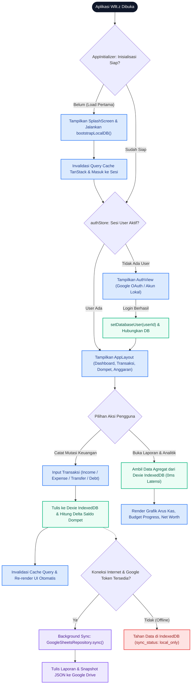
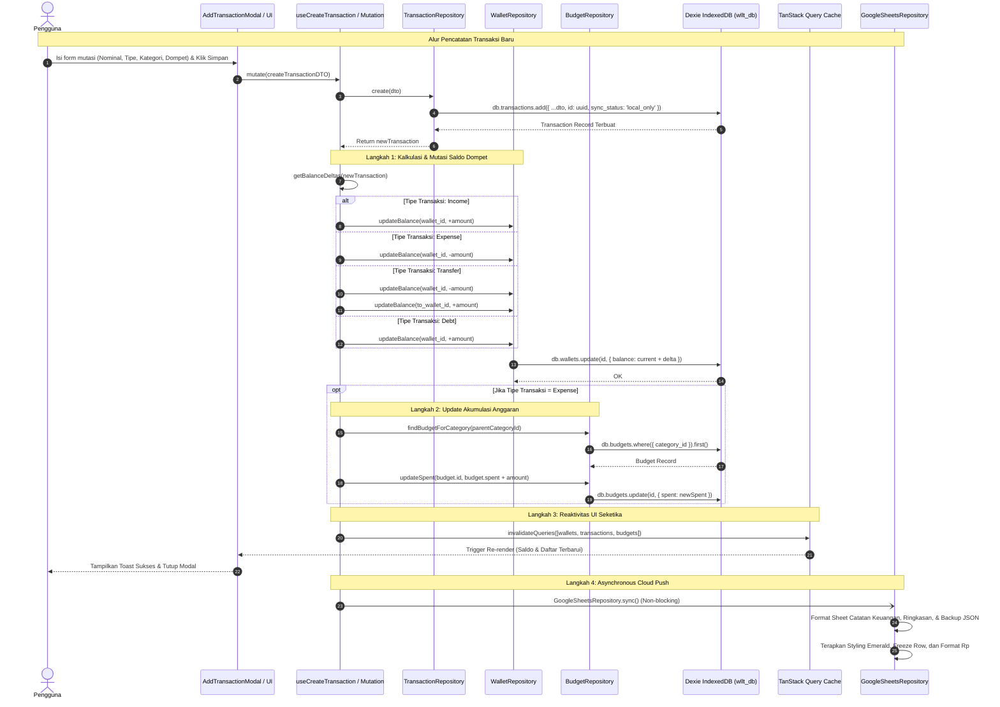
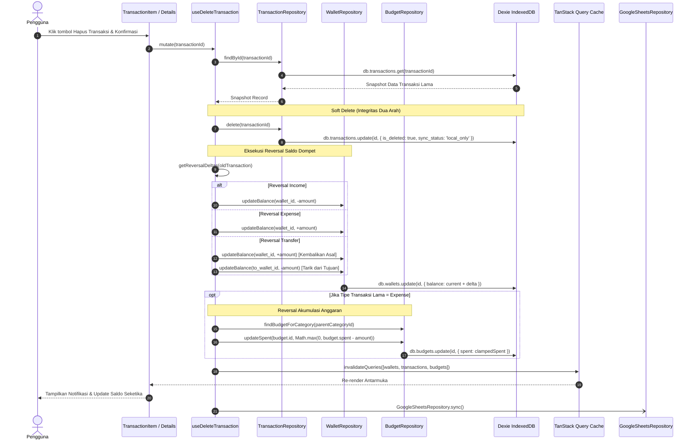

# Alur End-to-End Sistem Wllt.z: Arsitektur Local-First & Sinkronisasi Cloud — Wllt.z

> **Ruang Lingkup Modul:** End-to-End System Flow (Initialization, Auth, Transactions, Wallets, Budgets, Analytics, & Cloud Sync)  
> **Klasifikasi:** `[FACT]` & `[ASSESSMENT]`  
> **Penulis / Arsitek:** Senior Financial Software Architect & Enterprise Technical Writer  
> **Status Dokumen:** `[APPROVED / BASELINE]`  
> **Berkas Diagram Utama (Draw.io):** [`docs/assets/diagrams/wlltz_end_to_end_flow.drawio`](file:///home/rayanapi/IAN/Programing/Capstone%20Project%20UT/Wllt.z/docs/assets/diagrams/wlltz_end_to_end_flow.drawio)

---

## 1. Latar Belakang & Ruang Lingkup Bisnis

### A. Konteks & Filosofi Produk `[FACT]`
Aplikasi **Wllt.z** dirancang sebagai platform pencatatan keuangan pribadi dan akuntansi ringan (*Personal Finance & Light Accounting PWA*) modern dengan prinsip dasar:
1. **User Data Ownership (Kedaulatan Data Pengguna):** Data keuangan adalah privasi mutlak. Tidak ada server terpusat pengembang (*zero backend operational cost*), tidak ada basis data relasional privat, dan tidak ada pelacakan telemetri pihak ketiga.
2. **Local-First & Offline-First:** Pengguna dapat melakukan pencatatan transaksi kapan saja dan di mana saja tanpa tergantung koneksi internet. Penyimpanan lokal berbasis **Dexie.js (IndexedDB)** bertindak sebagai *single source of truth* primer dengan responsivitas antarmuka seketika (<16ms).
3. **Multi-Cloud User Storage:** Pengguna menyinkronkan data langsung ke Google Drive dan Google Sheets pribadi miliknya menggunakan cakupan minimal OAuth 2.0 (`drive.file`).

### B. Masalah yang Diselesaikan `[ASSESSMENT]`
- **Ketergantungan Server Finansial:** Sebagian besar aplikasi pencatatan keuangan menyimpan data pada cloud milik penyedia layanan yang rentan terhadap kebocoran data (*data breach*) atau penghentian layanan (*vendor lock-in*).
- **Latensi & Kegagalan Jaringan:** Input mutasi saat bepergian (misalnya di kasir tanpa sinyal) sering gagal pada aplikasi cloud murni. Wllt.z mengeliminasi kendala ini dengan paradigma *instant-write local database*.
- **Keterbacaan Data Akuntansi:** Sinkronisasi cloud Wllt.z tidak hanya mencadangkan format JSON mentah, melainkan menyusun laporan keuangan terformat rapi (*human-readable*) dengan formula otomatis (*SUM*, *Net Worth*, *Currency formatting*) yang dapat langsung dibuka dan diaudit di Google Sheets.

---

## 2. Diagram Alur Sistem (Mermaid Flow & Sequence)

Diagram visual interaktif lengkap dengan 4 halaman kanvas (Arsitektur Makro, Alur Transaksi & Saldo, Sinkronisasi Dua Arah, dan Bootstrapping & Multi-User) tersedia dalam format Draw.io di:
👉 **[`docs/assets/diagrams/wlltz_end_to_end_flow.drawio`](file:///home/rayanapi/IAN/Programing/Capstone%20Project%20UT/Wllt.z/docs/assets/diagrams/wlltz_end_to_end_flow.drawio)**

Berikut adalah visualisasi standar Mermaid untuk rendering langsung di IDE dan markdown viewer:

### A. Level 1: Alur Makro Pengguna (Macro User Journey Flow) `[FACT]`



---

### B. Level 2: Diagram Urutan Mutasi & Reversal Saldo (System Sequence Diagram) `[FACT]`



---

### C. Level 3: Diagram Urutan Pembalikan Saldo (Transaction Reversal / Deletion) `[FACT]`



---

## 3. Matriks Prosedur Langkah demi Langkah

Matriks berikut mendokumentasikan setiap alur transaksional dan operasional dalam aplikasi Wllt.z:

| No | Tahap / Alur | Aktor | Komponen Antarmuka | Hook / Service Pemroses | Skema & Operasi Basis Data | Validasi & Integritas |
| :--- | :--- | :--- | :--- | :--- | :--- | :--- |
| **1** | **Bootstrapping Aplikasi** | Sistem | `AppInitializer.tsx`, `SplashScreen.tsx` | `bootstrapLocalDB()` | Inisialisasi tabel Dexie: `categories`, `wallets`, `settings` | Menjamin data default (kategori & dompet utama) tersedia sebelum React me-render children. |
| **2** | **Otentikasi & Switch DB** | Pengguna | `AuthView.tsx`, GIS Client | `useAuthStore.loginWithGoogle` / `login` | `setDatabaseUser(userId)` &rarr; instance `wllt_db_${userId}` | Isolasi basis data per-user, database lokal akun lain tidak dapat diakses secara silang. |
| **3** | **Input Pemasukan / Pengeluaran** | Pengguna | `AddTransactionModal.tsx` | `useCreateTransaction()` | `db.transactions.add()`, `db.wallets.update()` | Validasi `amount > 0`, dompet aktif, resolusi `parent_id` untuk perhitungan anggaran. |
| **4** | **Mutasi Transfer Antar Dompet** | Pengguna | `AddTransactionModal.tsx` (`type: 'transfer'`) | `useCreateTransaction()` | `db.transactions.add()`, 2x `db.wallets.update()` | Menjamin debit dompet asal (`-amount`) identik dengan kredit dompet tujuan (`+amount`). |
| **5** | **Penghapusan Transaksi (Reversal)** | Pengguna | `TransactionItem.tsx` | `useDeleteTransaction()` | `db.transactions.update(is_deleted: true)` | Pembalikan mutasi saldo dompet secara sempurna dan pengurangan `spent` anggaran dengan *clamping* `Math.max(0, ...)`. |
| **6** | **Pembuatan & Manajemen Dompet** | Pengguna | `WalletsView.tsx`, `WalletModal.tsx` | `walletRepo.create()`, `walletRepo.update()` | `db.wallets.add()`, `db.wallets.put()` | Validasi nama unik, tipe dompet standar (`cash`, `bank`, `e-wallet`, `credit-card`), flag `exclude_from_total`. |
| **7** | **Penyusunan Anggaran (Budgeting)** | Pengguna | `BudgetsView.tsx`, `BudgetModal.tsx` | `budgetRepo.create()`, `budgetRepo.update()` | `db.budgets.add()`, `db.budgets.put()` | Alokasi limit bulanan ditautkan pada kategori level 1 (parent category). |
| **8** | **Monitoring Dashboard & Grafik** | Pengguna | `DashboardView.tsx`, `StatisticsView.tsx` | `useTransactions()`, `useWallets()`, `useBudgets()` | Dexie IndexedDB filtered read (`[type+date]`, `[wallet_id+date]`) | Penghitungan kekayaan bersih (*Net Worth*), persentase serapan anggaran, dan visualisasi arus kas bulanan. |
| **9** | **Sinkronisasi Otomatis Cloud** | Sistem | Background Worker / Async Hook | `GoogleSheetsRepository.sync()` | Google Drive API v3, Google Sheets API v4 | Penulisan data terformat (IDR, Freeze Headers, SUM Formulas) dan full JSON snapshot tanpa memblokir UI lokal. |
| **10** | **Sinkronisasi Dua Arah (Two-Way)** | Pengguna | `SettingsView.tsx` (Tombol Sync) | `GoogleSheetsRepository.syncTwoWay()` | `db.transaction('rw', ... bulkPut)` | Jika database lokal kosong (`count == 0`), jalankan `pullFromDrive()`. Jika ada data lokal, jalankan `pushToDrive()`. |

---

## 4. Pemetaan Teknis & Skema Data (Data Model Mapping)

### A. Dexie.js IndexedDB Schema (`src/db/index.ts`) `[FACT]`

Aplikasi menggunakan basis data IndexedDB bernama dinamis `wllt_db_${userId}` dengan tabel-tabel terindeks berikut:

```typescript
// Konfigurasi Skema Database (WlltDatabase Version 3)
this.version(3).stores({
  // Tabel Transaksi: Mendukung compound index untuk query cepat berdasarkan tanggal
  transactions: '&id, date, type, category_id, wallet_id, to_wallet_id, sync_status, is_deleted, [wallet_id+date], [type+date]',

  // Tabel Kategori: Mendukung hierarki dua tingkat (parent_id)
  categories: '&id, type, name, is_deleted, sync_status, parent_id',

  // Tabel Dompet: Mendukung penyaringan arsip dan pengecualian dari Total Kekayaan Bersih
  wallets: '&id, name, type, exclude_from_total, is_archived, is_deleted, sync_status',

  // Tabel Anggaran: Menautkan alokasi limit ke kategori induk dan periode
  budgets: '&id, category_id, wallet_id, period, is_deleted, sync_status',

  // Tabel Pengaturan: Rekaman singleton (id = 'default')
  settings: '&id',
})
```

### B. Struktur Entitas Data TypeScript (`src/types/index.ts`) `[FACT]`

```typescript
export type TransactionType = 'income' | 'expense' | 'transfer' | 'debt'
export type WalletType = 'cash' | 'bank' | 'e-wallet' | 'credit-card'
export type SyncStatus = 'local_only' | 'syncing' | 'synced' | 'failed' | 'conflict'

export interface Transaction {
  id: string              // UUID v4
  date: string            // YYYY-MM-DD
  title: string
  amount: number          // Nilai nominal positif
  type: TransactionType
  category_id: string     // Foreign key ke categories.id
  wallet_id: string       // Dompet asal / sumber
  to_wallet_id?: string | null // Dompet tujuan (khusus transfer)
  notes?: string | null
  receipt_url?: string | null
  sync_status: SyncStatus
  is_deleted: boolean     // Soft-delete flag
  created_at: string      // ISO Timestamp
  updated_at: string      // ISO Timestamp
}

export interface Wallet {
  id: string
  name: string
  type: WalletType
  balance: number         // Saldo saat ini (IDR)
  currency: string        // Default 'IDR'
  exclude_from_total: boolean // Jika true, diabaikan dari kalkulasi Net Worth
  is_archived: boolean
  is_deleted: boolean
  sync_status: SyncStatus
}

export interface Budget {
  id: string
  category_id: string     // Parent category ID
  limit: number           // Batas maksimal anggaran
  spent: number           // Akumulasi pengeluaran berjalan
  period: 'monthly' | 'weekly' | 'yearly'
  is_deleted: boolean
  sync_status: SyncStatus
}
```

### C. Pemetaan Struktur Google Sheets Spreadsheet `[FACT]`
Spreadsheet yang dihasilkan pada Google Drive pengguna memiliki judul baku:  
**`Catatan Keuangan Saya - Wllt.z`** (dengan mekanisme otomatis me-*rename* nama warisan lama `wllt.z_database`).

1. **Sheet 1 (`Catatan Keuangan`):**
   - Header Baris 4: `No`, `Tanggal`, `Jenis`, `Kategori`, `Dompet / Rekening`, `Judul / Keterangan`, `Pemasukan (Rp)`, `Pengeluaran (Rp)`, `Catatan Tambahan`.
   - Warna Header: *Dark Navy Blue* (`#1E3A8A`) dengan teks putih tebal dan *freeze 4 rows*.
   - Baris Total Formula Otomatis:
     - Total Pemasukan: `=SUM(G5:G{endRow})`
     - Total Pengeluaran: `=SUM(H5:H{endRow})`
     - Saldo Bersih: `=G{endRow+2}-H{endRow+2}`
   - Format Angka: Currency format Rupiah (`Rp #,##0`).
2. **Sheet 2 (`Ringkasan & Saldo Dompet`):**
   - Header: *Emerald Green* (`#14532D`) dengan teks putih tebal.
   - Tabel 1: Rekapitulasi nama dompet, tipe, dan saldo aktual saat ini.
   - Tabel 2: Rekapitulasi target anggaran, pengeluaran terpakai, dan sisa anggaran.
3. **Sheet 3 (`_wlltz_sync_data` — Hidden Sheet):**
   - Lembar tersembunyi yang menyimpan dump terstruktur JSON snapshot dari 4 tabel Dexie untuk keperluan *full restore* saat berpindah perangkat.

---

## 5. Integritas Keuangan & Mutasi Saldo (Financial Integrity Rules)

Aplikasi Wllt.z menerapkan aturan ketat akuntansi guna mencegah terjadinya distorsi angka keuangan:

### A. Formulasi Perhitungan Delta Saldo (`getBalanceDeltas`) `[FACT]`
Setiap transaksi yang dicatat atau diperbarui wajib mematuhi delta saldo berikut:
$$\Delta \text{Balance}(\text{Wallet}) = \begin{cases} 
+\text{amount}, & \text{jika } \text{type} = \text{'income'} \\
-\text{amount}, & \text{jika } \text{type} = \text{'expense'} \\
-\text{amount}, & \text{jika } \text{type} = \text{'transfer'} \text{ (pada dompet asal } \text{wallet\_id}) \\
+\text{amount}, & \text{jika } \text{type} = \text{'transfer'} \text{ (pada dompet tujuan } \text{to\_wallet\_id}) \\
+\text{amount}, & \text{jika } \text{type} = \text{'debt'} \text{ (kas diterima bertambah)}
\end{cases}$$

### B. Formulasi Pembalikan Saldo (`getReversalDeltas`) `[FACT]`
Saat pengguna menghapus transaksi (*soft delete*), sistem mengeksekusi operasi kebalikan tepat (*exact inverse*):
$$\Delta \text{Reversal}(\text{Wallet}) = -\Delta \text{Balance}(\text{Wallet})$$
- Menghapus Pemasukan: Saldo berkurang sebesar `-amount`.
- Menghapus Pengeluaran: Saldo dikembalikan sebesar `+amount`.
- Menghapus Transfer: Dompet asal dipulihkan `+amount`, dompet tujuan dikurangi `-amount`.

### C. Resolusi Anggaran Bertingkat (Parent-Category Budgeting) `[FACT]`
1. Anggaran (*Budgets*) selalu terikat pada **Kategori Induk** (*Top-Level Category*).
2. Jika transaksi pengeluaran menggunakan sub-kategori (misal: `Kopi` dengan `parent_id = 'Food & Drinks'`), sistem mencari anggaran aktif milik `parent_id`.
3. Jika transaksi pengeluaran dihapus, nilai serapan anggaran dikurangi dengan batas bawah nol (*clamping protection*):
   $$\text{newSpent} = \max(0, \text{budget.spent} - \text{txn.amount})$$

### D. Perhitungan Kekayaan Bersih (Net Worth Calculation) `[FACT]`
$$\text{Total Net Worth} = \sum_{w \in \text{Wallets}, \neg w.\text{is\_archived}, \neg w.\text{exclude\_from\_total}} w.\text{balance}$$

---

## 6. Skenario Ekstrem, Keamanan & Pemulihan (Edge Cases & Resilience)

| Skenario | Risiko / Potensi Masalah | Solusi & Penanganan Wllt.z | Bukti Implementasi |
| :--- | :--- | :--- | :--- |
| **Perangkat Offline (Tidak Ada Sinyal)** | Transaksi gagal dicatat jika sistem bergantung pada API server. | Data tetap sukses disimpan ke Dexie IndexedDB lokal secara instan. Field `sync_status` diberi nilai `'local_only'`. UI merespons tanpa hambatan. | `TransactionRepository.ts` & `useCreateTransaction.ts` |
| **Token OAuth Google Kedaluwarsa (401)** | Aplikasi crash atau me-logout pengguna secara paksa. | Error 401 ditangkap oleh `handleApiError()`. Token di-reset ke `null`, pengguna diberi indikasi visual untuk login ulang Google, namun aplikasi **tetap terbuka dan dapat digunakan secara offline**. | `GoogleSheetsRepository.ts:17-26` |
| **Race Condition Saat Booting Awal** | React Query mengambil data kosong sebelum seeder selesai mengisi IndexedDB, lalu mengunci cache kosong dengan `staleTime: Infinity`. | `AppInitializer` menggunakan sequential gate: menahan render anak di balik `SplashScreen`, menjalankan `bootstrapLocalDB()`, lalu mengeksekusi `queryClient.invalidateQueries()`. | `AppInitializer.tsx:128-160` |
| **Multi-User pada Perangkat yang Sama** | Data akun satu pengguna bercampur dengan pengguna lain di browser yang sama. | Multi-Tenancy dinamis via `setDatabaseUser(userId)`. Nama database IndexedDB diisolasi menjadi `wllt_db_${userId}`. Instance diproxy secara dinamis. | `src/db/index.ts:111-143` |
| **Device Baru Tanpa Data Lokal (Empty State)** | Pengguna login di handphone baru dan melihat saldo Rp 0 padahal memiliki catatan di Google Drive. | `syncTwoWay()` memeriksa `localTxCount`. Jika 0, secara cerdas memanggil `pullFromDrive()`, mem-parsing tab `_wlltz_sync_data`, dan me-restore seluruh database via `bulkPut`. | `GoogleSheetsRepository.ts:820-835` |
| **Nama Spreadsheet Lawas** | Spreadsheet Google Drive masih menggunakan nama v1 `wllt.z_database`. | `getOrCreateSpreadsheet()` mendeteksi nama lama dan secara otomatis mengirimkan request `PATCH` ke Drive API v3 untuk memperbarui nama menjadi `Catatan Keuangan Saya - Wllt.z`. | `GoogleSheetsRepository.ts:49-62` |

---

## 7. Riwayat Revisi Dokumen (Document Change History)

| Versi | Tanggal (WIB) | Penulis / Reviewer | Status | Ringkasan Perubahan |
| :--- | :--- | :--- | :--- | :--- |
| **1.0.0** | 2026-10-24 | Senior Financial Software Architect | `[APPROVED / BASELINE]` | Rilis baseline dokumentasi alur end-to-end Wllt.z, integrasi diagram Draw.io 4-kanvas (`docs/assets/diagrams/wlltz_end_to_end_flow.drawio`), diagram Mermaid Level 1-3, matriks prosedur, data model Dexie & Sheets, serta aturan integritas finansial. |
