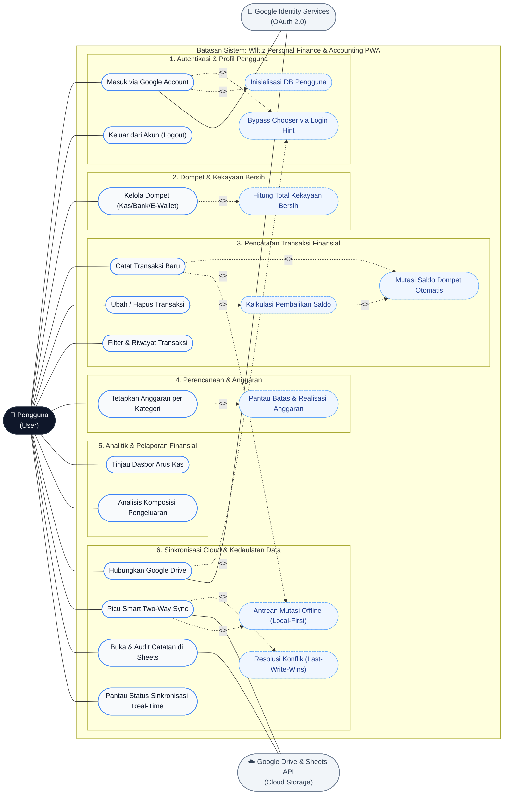

# Diagram Use Case Sistem Wllt.z: Arsitektur Local-First & Integrasi Google Cloud — Wllt.z

> **Ruang Lingkup Dokumen:** Pemodelan Fungsional Sistem (UML Use Case Diagram & Deskripsi Spesifikasi Kasus Penggunaan)  
> **Klasifikasi:** `[FACT]` & `[ASSESSMENT]`  
> **Penulis / Arsitek:** Senior Financial Software Architect & Enterprise Technical Writer  
> **Status Dokumen:** `[APPROVED / BASELINE]`  
> **Versi:** 2.0 (Diperbarui pasca-implementasi Smart Two-Way Sync & Auto-Account Selection)  

---

## 1. Latar Belakang & Ruang Lingkup Pembaruan `[FACT]`

Sistem **Wllt.z** telah mengalami sejumlah evolusi arsitektur dan penyesuaian fungsionalitas kunci:
1. **Autentikasi Terpadu & Auto-Account Selection:** Penyesuaian Google Identity Services (GIS) yang menyertakan parameter `hint` untuk mengeliminasi dialog pemilihan akun ganda saat menghubungkan Google Drive.
2. **Smart Two-Way Sync (Merge 2 Arah):** Penyatuan repositori lokal Dexie IndexedDB dengan Google Sheets melalui mekanisme rekonsiliasi berbasis cap waktu (`updated_at` *last-write-wins*) tanpa risiko data saling menimpa.
3. **Penyatuan Status & Trigger Sinkronisasi:** Integrasi tombol sinkronisasi manual langsung ke dalam indikator status badge (*Synced, Syncing, Pending Offline, Offline*).
4. **Audit Terbuka (Buka Catatan Saya):** Kemudahan pengguna untuk mengakses dan mengaudit berkas Google Sheets secara langsung melalui tautan aman.

Dokumen ini merevisi diagram *Use Case* sistem secara menyeluruh guna merefleksikan fungsionalitas terkini sesuai standar UML enterprise.

---

## 2. Aktor Sistem (System Actors) `[FACT]`

| Aktor | Tipe | Peran & Tanggung Jawab dalam Sistem |
| :--- | :--- | :--- |
| **Pengguna (User)** | Aktor Primer (*Human*) | Pemilik akun dan pencatat keuangan. Berinteraksi langsung dengan antarmuka PWA untuk mencatat transaksi, mengelola dompet, memantau anggaran, serta mengontrol sinkronisasi. |
| **Sistem Wllt.z (Client PWA & IndexedDB)** | Aktor Sekunder (*Local System*) | Mengelola *local-first persistence*, validasi integritas transaksi, kalkulasi otomatis saldo/reversal, serta penjadwalan antrean offline (*offline queue*). |
| **Google Identity Services (GIS)** | Aktor Sekunder (*External Service*) | Penyedia autentikasi OAuth 2.0 terdesentralisasi, verifikasi identitas, dan penerbitan token akses (`drive.file`, `spreadsheets`). |
| **Google Cloud (Drive & Sheets API)** | Aktor Sekunder (*External Service*) | Penyimpan cadangan cloud pribadi (*User-Owned Cloud Storage*), tempat file spreadsheet keuangan dibuat, diperbarui, dan diaudit. |

---

## 3. Diagram Use Case Lengkap (UML Mermaid) `[FACT]`

---

## 4. Matriks Spesifikasi Detail Use Case `[FACT]`

### A. Klaster Autentikasi & Akun
| Kode UC | Nama Kasus Penggunaan | Aktor Terlibat | Deskripsi & Aturan Bisnis |
| :--- | :--- | :--- | :--- |
| **UC-01** | Masuk via Google Account | Pengguna, GIS | Pengguna melakukan otentikasi menggunakan Google Identity Services tanpa membuat kata sandi baru. Token akses disimpan di memori sesi. |
| **UC-02** | Bypass Chooser via Login Hint | GIS, Sistem Wllt.z | Menyematkan `hint: currentUser.email` dan `prompt: ''` sehingga Google langsung memilih akun aktif tanpa memunculkan daftar *account picker*. |
| **UC-03** | Inisialisasi DB Pengguna | Sistem Wllt.z | Memanggil `setDatabaseUser(userId)` untuk memisahkan partisi database Dexie IndexedDB dan memuat kategori serta dompet default. |
| **UC-04** | Keluar dari Akun (Logout) | Pengguna, Sistem Wllt.z | Menghapus token memori dan data sesi aktif, lalu mengembalikan konteks database ke kondisi terisolasi. |

### B. Klaster Pengelolaan Dompet & Transaksi
| Kode UC | Nama Kasus Penggunaan | Aktor Terlibat | Deskripsi & Aturan Bisnis |
| :--- | :--- | :--- | :--- |
| **UC-05** | Kelola Dompet | Pengguna, Sistem Wllt.z | Menambah, menyunting nama/ikon, atau menonaktifkan akun keuangan (Kas Tunai, Rekening Bank, Dompet Digital). |
| **UC-06** | Hitung Total Kekayaan Bersih | Sistem Wllt.z | Menjumlahkan seluruh saldo aktif dari dompet yang terdaftar secara real-time (`Net Worth = Total Aset - Total Liabilitas`). |
| **UC-07** | Catat Transaksi Baru | Pengguna, Sistem Wllt.z | Mencatat pengeluaran, pemasukan, mutasi transfer antar-dompet, atau hutang-piutang. Data langsung disimpan di IndexedDB (<16ms). |
| **UC-08** | Mutasi Saldo Dompet Otomatis | Sistem Wllt.z | Menghitung delta perubahan saldo: Pemasukan (`+`), Pengeluaran (`-`), Transfer (`-asal, +tujuan`). |
| **UC-09** | Ubah / Hapus Transaksi | Pengguna, Sistem Wllt.z | Memperbarui nominal, dompet, atau kategori transaksi, atau membatalkan mutasi transaksi secara permanen. |
| **UC-10** | Kalkulasi Pembalikan Saldo (*Reversal*) | Sistem Wllt.z | Secara otomatis membalikkan mutasi saldo sebelum nilai baru diterapkan guna menjaga keakuratan neraca keuangan. |

### C. Klaster Anggaran, Analitik & Pelaporan
| Kode UC | Nama Kasus Penggunaan | Aktor Terlibat | Deskripsi & Aturan Bisnis |
| :--- | :--- | :--- | :--- |
| **UC-11** | Tetapkan Anggaran Bulanan | Pengguna, Sistem Wllt.z | Mengalokasikan batas maksimal belanja per kategori untuk periode bulan berjalan. |
| **UC-12** | Pantau Realisasi Anggaran | Sistem Wllt.z | Mengagregasi total pengeluaran per kategori secara reaktif dan menyajikan visualisasi progress bar serta indikator peringatan (*threshold*). |
| **UC-13** | Tinjau Dasbor Arus Kas | Pengguna, Sistem Wllt.z | Menampilkan ringkasan total pemasukan, pengeluaran, dan sisa arus kas bersih bulanan. |
| **UC-14** | Analisis Komposisi Pengeluaran | Pengguna, Sistem Wllt.z | Menghasilkan grafik distribusi belanja per kategori (Pie/Radar chart) untuk evaluasi gaya hidup finansial. |

### D. Klaster Sinkronisasi Cloud Dua Arah (Google Drive & Sheets)
| Kode UC | Nama Kasus Penggunaan | Aktor Terlibat | Deskripsi & Aturan Bisnis |
| :--- | :--- | :--- | :--- |
| **UC-15** | Hubungkan Google Drive | Pengguna, GIS, GDrive | Mengotorisasi cakupan `drive.file` dan `spreadsheets` secara seamless menggunakan email aktif pengguna. |
| **UC-16** | Picu Smart Two-Way Sync | Pengguna, Sistem Wllt.z, GDrive | Menjalankan penyelarasan dua arah cerdas: mengunduh mutasi cloud terbaru, memadukan dengan transaksi lokal, dan memperbarui spreadsheet. |
| **UC-17** | Resolusi Konflik (*Last-Write-Wins*) | Sistem Wllt.z | Menggunakan cap waktu `updated_at` untuk menentukan versi data paling mutakhir tanpa menghapus transaksi unik pada masing-masing sisi. |
| **UC-18** | Antrean Mutasi Offline (*Local-First*) | Sistem Wllt.z | Menandai transaksi yang dicatat saat offline dengan flag `local_only` dan memicu background sync seketika koneksi pulih. |
| **UC-19** | Pantau Status Sinkronisasi | Pengguna, Sistem Wllt.z | Memantau badge visual di navbar (*Synced, Syncing, Pending, Offline, Error*) yang juga berfungsi sebagai tombol manual sync. |
| **UC-20** | Buka & Audit Catatan di Sheets | Pengguna, GDrive | Membuka tautan langsung berkas Google Sheets resmi pengguna untuk melihat neraca terformat dengan formula akuntansi otomatis. |

---

## 5. Hubungan Antar-Use Case (Include & Extend Analysis) `[ASSESSMENT]`

### A. Hubungan *<<include>>* (Wajib Dilakukan)
1. **`UC_CreateTx` $\xrightarrow{<<include>>}$ `UC_UpdateBalance`:** Setiap pencatatan transaksi mutlak memperbarui saldo dompet terkait secara atomik.
2. **`UC_EditDeleteTx` $\xrightarrow{<<include>>}$ `UC_BalanceReversal`:** Setiap perubahan atau penghapusan transaksi mewajibkan pembalikan efek saldo lama sebelum menerapkan efek saldo baru.
3. **`UC_SmartSync` $\xrightarrow{<<include>>}$ `UC_ConflictResolve`:** Sinkronisasi dua arah mutlak melalui mekanisme resolusi konflik agar data lokal dan cloud konsisten tanpa duplikasi.
4. **`UC_Auth` $\xrightarrow{<<include>>}$ `UC_BootstrapDB`:** Selesai proses login, sistem wajib menyiapkan partisi database IndexedDB pengguna (`bootstrapLocalDB`).
5. **`UC_ConnectDrive` $\xrightarrow{<<include>>}$ `UC_AutoHint`:** Integrasi Google Drive menyertakan identitas email pengguna yang aktif untuk meniadakan seleksi akun ulang.

### B. Hubungan *<<extend>>* (Kondisional / Perluasan)
1. **`UC_CreateTx` $\xleftarrow{<<extend>>}$ `UC_OfflineQueue`:** Jika transaksi dilakukan saat perangkat tidak terhubung ke internet, alur diperluas dengan memasukkannya ke antrean lokal berstatus `local_only`.
2. **`UC_SmartSync` $\xleftarrow{<<extend>>}$ `UC_OfflineQueue`:** Ketika koneksi pulih dan sinkronisasi dipicu, antrean offline otomatis diunggah dan statusnya diubah menjadi `synced`.

---

## 6. Protokol Review Pasca-Penyusunan (4-Vector Review Gate)

- [x] **Vektor 1 (Integritas Logika Finansial & Akuntansi):** Alur saldo dompet, pembalikan mutasi (*reversal*), dan perhitungan kekayaan bersih terakomodasi secara terstruktur.
- [x] **Vektor 2 (Kelayakan Teknis Codebase Wllt.z):** Use case mencerminkan implementasi aktual pada hook `useSyncStatus`, repositori `GoogleSheetsRepository`, dan komponen `SettingsView`.
- [x] **Vektor 3 (Kesesuaian Dokumentasi Standar Wllt.z):** Disusun dalam Bahasa Indonesia formal dengan terminologi teknis baku dan penanda epistemik `[FACT]` & `[ASSESSMENT]`.
- [x] **Vektor 4 (Kebersihan File & Zero-Waste):** Dokumen disimpan secara terstruktur pada [`docs/technical/use_case_diagram_wlltz.md`](file:///home/rayanapi/IAN/Programing/Capstone%20Project%20UT/Wllt.z/docs/technical/use_case_diagram_wlltz.md) tanpa meninggalkan berkas sementara.
